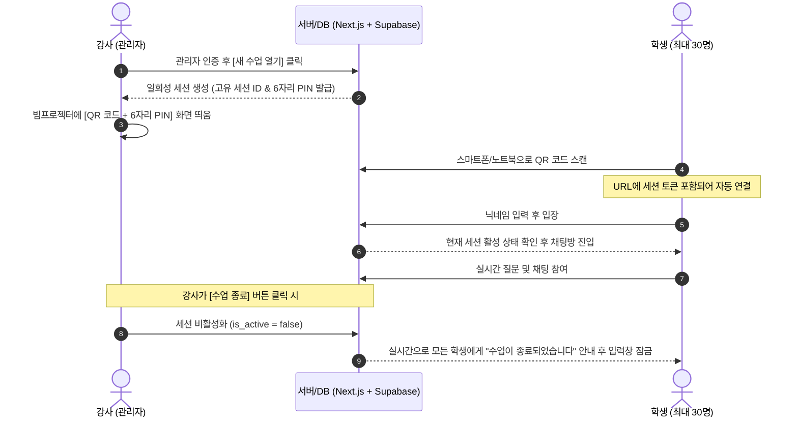

# 수업용 실시간 채팅 웹사이트 상세 설계서 (QR 입장 & 세션 제어)

## 1. 핵심 아키텍처 및 추천 스택

> **스택: Next.js (TypeScript) + Supabase Realtime + Tailwind CSS**  
> - **강사(관리자)**: 수업 시작 시 "방 열기" 클릭 -> 빔프로젝터용 **QR 코드 & 6자리 PIN** 생성 및 수업 통제
> - **학생**: QR 코드 스캔 후 **닉네임만 입력**하여 즉시 참여 (회원가입 X)
> - **수업 외 분탕 방지**: 수업 종료 시 방이 닫히며, 이전 링크로 접근해도 입장 및 메시지 전송 불가

---

## 2. 수업 전용 QR/세션 입장 및 보안 워크플로우



---

## 3. 분탕 방지 및 접근 제어 핵심 메커니즘

1. **가변 세션(Dynamic Session) & 일회성 QR 코드**:
   - 수업마다 새로운 세션 ID(UUID)와 6자리 PIN이 생성됩니다.
   - 지난 수업 URL이나 QR 코드를 북마크해 두었더라도, 해당 세션이 종료되면 접속할 수 없습니다.
2. **강사 제어 센터 (Admin Control Panel)**:
   - **방 열기 / 닫기**: 수업 시작 시 열고, 끝나면 버튼 하나로 즉시 세션 종료.
   - **채팅 일시 정지 (Mute/Freeze)**: 강사가 설명 중일 때 채팅 입력을 일시 차단.
   - **문제 메시지 삭제 및 유저 강퇴 (Kick)**: 부적절한 메시지 즉시 삭제 및 해당 닉네임 차단.
3. **학생 입장 간소화**:
   - 학생은 회원가입/로그인 없이 **오직 닉네임만** 입력하면 3초 만에 입장 완료.
   - 모바일 최적화 반응형 UI (스마트폰 카메라로 QR 찍자마자 브라우저에서 바로 열림).

---

## 4. 데이터베이스 스키마 설계 (PostgreSQL / Supabase)

```sql
-- 1. 수업 세션 테이블
CREATE TABLE sessions (
    id UUID PRIMARY KEY DEFAULT gen_random_uuid(),
    title VARCHAR(100) DEFAULT '오늘의 수업',
    pin_code VARCHAR(6) NOT NULL,          -- 6자리 숫자 입장 코드
    is_active BOOLEAN DEFAULT true,        -- 수업 진행 중 여부
    is_chat_muted BOOLEAN DEFAULT false,   -- 채팅 일시 정지 여부
    created_at TIMESTAMP WITH TIME ZONE DEFAULT NOW(),
    closed_at TIMESTAMP WITH TIME ZONE
);

-- 2. 메시지 테이블
CREATE TABLE messages (
    id UUID PRIMARY KEY DEFAULT gen_random_uuid(),
    session_id UUID REFERENCES sessions(id) ON DELETE CASCADE,
    sender_name VARCHAR(30) NOT NULL,
    content TEXT NOT NULL,
    is_deleted BOOLEAN DEFAULT false,      -- 강사 삭제 여부
    created_at TIMESTAMP WITH TIME ZONE DEFAULT NOW()
);

-- 인덱스
CREATE INDEX idx_sessions_active ON sessions(is_active);
CREATE INDEX idx_messages_session ON messages(session_id, created_at ASC);
```

---

## 5. 주요 화면 및 라우트 구성

* `/`: 학생 입장 화면 (수업 PIN 코드 + 닉네임 입력창)
* `/join?session=[UUID]&pin=[CODE]`: QR 스캔 시 랜딩되는 화면 (PIN 자동 입력 -> 닉네임만 치면 입장)
* `/chat/[sessionId]`: 실제 채팅 화면 (메시지 목록, 전송창, 현재 온라인 인원수 표시)
* `/admin`: 강사용 대시보드 (비밀번호 입력 후 진입 -> QR 코드 크게 띄우기, 세션 열기/닫기, 채팅 얼리기)

---

## 6. 개발 단계별 진행 계획

1. **Next.js 프로젝트 셋업** (TypeScript, Tailwind, shadcn/ui, `qrcode.react`)
2. **Supabase 연동** (세션 테이블 & 메시지 테이블, Realtime Pub/Sub 활성화)
3. **강사 전용 화면 (`/admin`) 개발**:
   - 세션 생성, QR 코드 대형 디스플레이(빔프로젝터용 모드), 세션 On/Off 제어
4. **학생 채팅 화면 개발**:
   - QR 스캔 자동 진입, 닉네임 입력, 실시간 메시지 송수신, 세션 종료 시 실시간 비활성화 처리
5. **Vercel 원클릭 배포 및 실기기 테스트**
